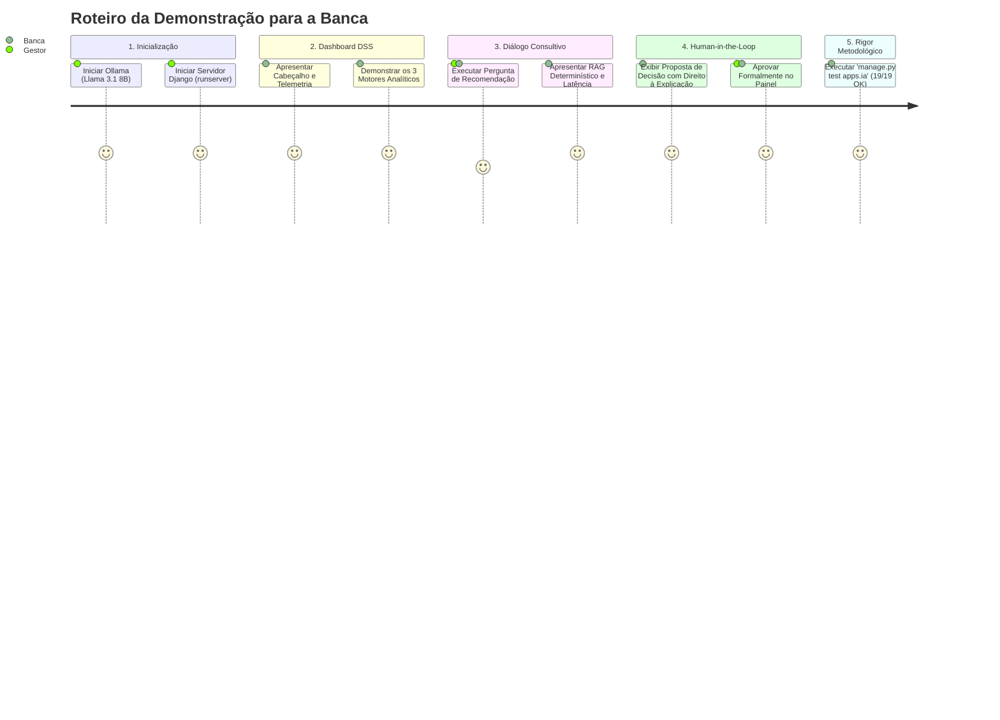

# 🎓 Guia de Demonstração Prática do Protótipo ELISE IA para a Banca do TCC
## Sistema de Suporte à Decisão (DSS) para Gestão Escolar com IA Local (Llama 3.1 8B)

Este guia apresenta o roteiro sequencial, objetivo e testado para a **apresentação ao vivo do protótipo perante a banca examinadora do TCC**, demonstrando cada funcionalidade técnica, a governança *Human-in-the-Loop* e a conformidade estrita com a LGPD.

---

## ⏱️ Roteiro da Demonstração (Duração Estimada: 10 a 15 minutos)



---

## 🛠️ Passo 1: Inicialização do Ambiente Local

Abra dois terminais PowerShell no diretório do projeto:

### Terminal 1 — Servidor de Inferência Local (Ollama)
```powershell
# Inicia o motor de inferência local na porta padrão 11434
ollama serve
```
> **Nota para a banca:** Destacar que o modelo roda 100% *on-premise* em CPU, garantindo que nenhum dado escolar ou financeiro seja trafegado para nuvens públicas ou servidores de terceiros (soberania de dados e LGPD).

### Terminal 2 — Servidor Web Django (SIGE)
```powershell
cd c:\Users\gu268\Projetos\Django-projetos\SIGE
..\venv\Scripts\activate
python manage.py runserver 8000
```
> Acesse o navegador em: [http://localhost:8000/ia/](http://localhost:8000/ia/) (efetue login com usuário gestor ou staff).

---

## 🖥️ Passo 2: Demonstração do Dashboard Executivo (`/ia/`)

1. **Cabeçalho Executivo**:
   - Aponte o indicador pulsante verde (*Online*): modelo `llama3.1:8b` detectado na máquina local.
   - Mostre o botão "Diagnosticar Motores", que dispara a reavaliação dos 3 domínios em tempo real.
2. **Card do Motor 1 (Enturmação e Inclusão PCD)**:
   - Mostre a identificação automática da assimetria do 1º Ano ($\Delta = 17$ alunos entre 1ºA e 1ºB).
   - Destaque o alerta pedagógico de concentração de 3 alunos PCD na mesma turma.
3. **Card do Motor 2 (Infraestrutura e Espaços Físicos)**:
   - Mostre a taxa global de avaria patrimonial (26,4% de 250 itens).
   - Aponte a necessidade de manutenção da Sala 101 (33% de avaria) e a ociosidade da Sala 102.
4. **Card do Motor 3 (Sustentabilidade Financeira de Turmas)**:
   - Mostre a linha de corte do ponto de equilíbrio (*Break-even* de 15 alunos por turma).
   - Aponte as turmas deficitárias (1ºB com déficit de R$ 1.500,00 e 3ºB com déficit de R$ 2.000,00).

---

## 💬 Passo 3: Diálogo Consultivo em Linguagem Natural (Chat Web)

1. No campo de pergunta do Chat integrado, selecione um atalho rápido ou digite:
   > *"Como gestor escolar, analisando as turmas de 2026, o que você recomenda para equilibrar a lotação e a inclusão pedagógica de PCDs?"*
2. **O que explicar à banca enquanto a inferência processa**:
   - O classificador de intenção roteia deterministicamente para o Motor 1 (`ENTURMACAO`).
   - O RAG estruturado injeta exclusivamente métricas agregadas pré-calculadas pelo Django ORM.
   - A LLM atua apenas como sintetizadora e redatora, **nunca realizando operações aritméticas**, eliminando o risco de alucinação numérica.
3. **Na exibição da resposta**:
   - Mostre que a resposta cita os números exatos do banco (29 alunos vs 12 alunos; 3 PCDs vs 0 PCDs).
   - Aponte o badge de latência e a observação ética obrigatória: *"Protótipo experimental: valide as sugestões antes de tomar qualquer decisão."*

---

## ⚖️ Passo 4: Deliberação Human-in-the-Loop (Art. 20 LGPD)

1. No painel lateral **"Propostas de Apoio à Decisão"**, localize a proposta pendente gerada pelo Motor 1:
   - **Título**: *Balanceamento de Turmas: 1o Ano A (2026) e 1o Ano B (2026)*.
   - **Direito à Explicação**: exiba a justificativa legal detalhada gerada pelo sistema.
2. Demonstre a deliberação manual pelo gestor:
   - Digite no campo de observação: *"Aprovado conforme deliberação da equipe pedagógica na reunião de planejamento."*
   - Clique em **"Aprovar Decisão"**.
3. **Comprovação**:
   - O status muda visualmente para `APROVADA` (badge verde).
   - Os botões de ação são bloqueados.
   - O banco de dados registra permanentemente: `decidido_por = gestor`, `decidido_em = timestamp` e a observação digitada (rastreabilidade e compliance regulatório).

---

## 🧪 Passo 5: Prova de Rigor Científico — Execução da Suíte de Testes

Para finalizar a apresentação perante a banca com autoridade técnica irrefutável, abra o terminal e execute:

```powershell
python manage.py test apps.ia
```

**Resultado esperado a ser projetado para a banca**:
```text
Creating test database for alias 'default'...
...................
----------------------------------------------------------------------
Ran 19 tests in 68.583s

OK
```

**Significado dos 19 testes automatizados**:
- **3 testes de modelos**: integridade de sessões, mensagens e ciclo de vida de decisões.
- **4 testes de contexto RAG**: classificação semântica e conformidade estrita de privacidade (LGPD).
- **6 testes de motores analíticos**: exatidão dos algoritmos de enturmação, avarias e break-even.
- **6 testes de interface e views**: autenticação, REST APIs e deliberação via HTTP.
